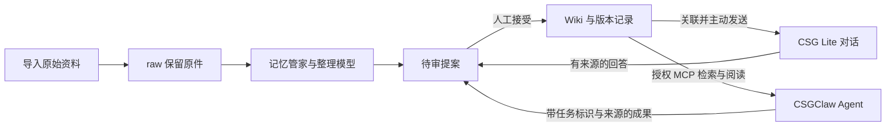

# CSG Lite 知识库：共用资料层

知识库保存资料与已确认知识，记忆管家组织整理流程，CSG Lite 模型与对话使用知识，CSGClaw 调用知识工具并提交成果。各入口共用同一份知识状态，避免各自复制整库形成不同版本。

## 产品分工

| 位置 | 已实现行为 | 边界 |
| --- | --- | --- |
| 知识工作区 | 原生 Preact 页面与 Go 服务；文件树、Markdown、双链、图谱、审阅、版本 | 自有实现，不嵌入 Obsidian 客户端；磁盘修改尚不双向同步 |
| 模型管理 | 共用 CSG Lite 模型目录和推理通道；每库保存整理首选模型及来源 | 模型运行参数仍由模型管理维护；本地和云端来源不会隐式互换 |
| 原生 Chat | 整库或单页创建知识对话；回答带引用时可保存为待审稿 | 打开入口不自动发送；每次发送重新检查来源和页面状态 |
| 记忆管家 | 选资料、排队、手动执行、取消、失败重试、生成待审稿、结构健康检查 | 没有后台自动调度、自动发布、语义事实核查或长期画像 |
| CSGClaw | MCP 检索/阅读有效 Wiki、提交待审稿；独立连接凭证、权限、有效期和撤销 | 用户另行配置连接器并绑定 Agent；不自动安装、重启、派发任务或同步任务状态 |
| 分享与迁移 | 有效 Wiki 的离线 ZIP；完整知识状态的 JSON 备份与新库恢复 | 固定快照无在线撤回能力；备份不带连接凭证，不是模型或聊天历史备份 |

## 资料流转

原件保存输入证据，Wiki 保存当前整理结果，聊天快照记录当次页面版本与原件哈希，Claw 提案记录连接、任务、运行和请求标识。外部客户端提供的任务标识用于追溯，不代表 Lite 已独立核实该任务执行成功。

来源撤回后，相关 Wiki 标记为待复核，不再进入后续有效上下文或分享快照；历史版本和历史聊天仍保留当时记录。提案接受时重新检查整个变更批次的来源和基础版本，冲突不会部分覆盖页面。

## 三条模型与知识通路

| 通路 | 发出的内容 | 限制 |
| --- | --- | --- |
| Chat 关联知识 | 问题和匹配的有效 Wiki 摘录，附页面/来源身份 | 最多 5 页、24,000 字符正文；不自动附加原件全文 |
| 管家整理 | 显式选择的原件正文，加相关有效 Wiki | 1–8 份原件、合计 64 KiB；最多 5 篇相关 Wiki、合计 24,000 UTF-8 字节；单次 120 秒 |
| MCP 知识工具 | 授权库中的有效 Wiki、页面版本、来源 ID/标题/哈希 | 搜索默认 5 项、最多 10 项，每项 600 字符摘录；阅读每次最多 8,000 Unicode 字符；不提供原件读取工具 |

管家使用配置的模型和来源调用原生推理处理器；具体服务地址由模型配置决定。云端模型会收到上述选定内容。本地模型也需要已配置且可运行；无模型时明确提示配置缺失或失败，不生成模拟成功结果。

当前检索为库内轻量文本匹配，包含中文连续双字匹配；尚无持久化向量索引、文件分块索引或 TB 级性能承诺。知识与模型服务分别配置，建立 MCP 连接不会自动配好 Claw 的推理模型。

## 授权与本机边界

管理接口及 MCP 都受 loopback、Host 和 Origin 检查保护，不通过外部推理监听器开放。浏览器操作使用同源管理 API；Claw 后端使用带 Bearer 凭证的 MCP 接口。本版不开放跨站管理 CORS 或远程知识访问。

一个凭证对应一个库，读取权限和待审稿提交权限分别校验。需要独立撤销的 Agent 应分别创建凭证及 Claw 连接器资源；多个 Agent 共用凭证时，Lite 将其视为同一授权身份。名称或请求中的任务 ID 不是额外身份认证。

关闭库读取权限会阻止已有凭证继续访问；关闭草稿权限会阻止后续提交及接受 Claw 稿件。连接撤销、到期或授权记录不存在时，该连接的既有待审稿也不能被接受。重新建连接后，应重新审查资料并提交新稿，不能用新凭证追认旧身份。

## 接口与实现入口

| 范围 | 接口 | 实现 |
| --- | --- | --- |
| 知识管理、审阅 | `/api/knowledge/libraries/{library}` 及其子路由 | [知识处理器](../../internal/server/handlers_knowledge.go)、[规范状态](../../internal/knowledge/store.go) |
| 管家与健康检查 | `GET …/{library}/steward`；`POST …/{library}/steward/jobs`；`POST …/jobs/{job}/{run,cancel,retry}` | [管家](../../internal/knowledge/steward.go)、[模型调用](../../internal/server/handlers_knowledge_steward.go) |
| 连接管理 | `GET/POST …/{library}/connections`；`POST …/connections/{connection}/revoke` | [连接授权](../../internal/knowledge/connector.go) |
| MCP | `POST /api/knowledge/mcp` | [协议处理器](../../internal/server/handlers_knowledge_connector.go)，协议版本 `2025-06-18` |
| 备份与恢复 | `GET …/{library}/backup`；`POST /api/knowledge/restore` | [备份校验](../../internal/knowledge/backup.go)、[HTTP 处理器](../../internal/server/handlers_knowledge_backup.go) |
| 工作区交互 | `/knowledge` | [主页面](../../web/src/pages/Knowledge.tsx)、[管家/连接/备份](../../web/src/pages/KnowledgeWorkflows.tsx) |

表中 `…/{library}` 代表 `/api/knowledge/libraries/{library}`，任务操作为该库的 `/steward/jobs/{job}/{操作}` 子路由。准确请求结构以 [本地 API 定义](../../openapi/local-api.json) 和实现为准。MCP 的工具与客户端配置见 [CSGClaw 接入指南](CSGCLAW.zh-CN.md)。

## 后续范围

数据集显式转入原件、PDF/DOCX/OCR、外部文件同步、增量索引、可编辑的长期记忆、在线分享和企业成员权限尚未交付。自动向 CSGClaw 派发任务及显示完整进度还需要其任务接口适配。当前范围为受控知识使用和人工审阅回流。
